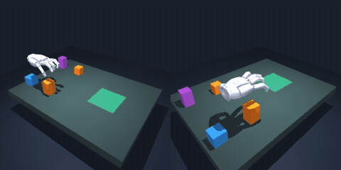

# World Model Gym

This repository contains the MuJoCo dexterous manipulation simulator and the **CIS 6280 course assignment on four-box stacking with a latent world model**. A simulated 22-joint Sharpa Wave five-finger hand mounted on a 3-DoF wrist stage must grasp and stack four boxes (two 55 mm and two 85 mm tall) in a goal zone using only two wrist-camera RGB views.

<p align="center">
  
</p>

## Course Assignment

Start with **[`assignment/README.md`](assignment/README.md)** for an overview of the task. The assignment offers two tracks:

- **[Planning Track (`assignment/planning/`)](assignment/planning/README.md)** — Keep our pretrained latent world model and action-chunk policy frozen, and design a test-time planner that scores candidate action chunks against visual subgoals. You can run and edit the entire baseline in Google Colab through [`assignment/planning/colab.ipynb`](assignment/planning/colab.ipynb) without local setup.
- **[Training Track (`assignment/training/`)](assignment/training/README.md)** — Build the five-stage pipeline from scratch, covering demonstration collection, world-model pretraining, diffusion-forcing policy training, on-policy predictor finetuning, and parallel closed-loop evaluation. Every stage has a pretrained artifact on Hugging Face so that you can start at whichever stage you want to explore.

## Local Installation

If you are running the training track or evaluating planners locally on Linux or macOS, create the Python environment and download the Sharpa Wave hand meshes with the setup script:

```bash
bash scripts/setup.sh
```

For headless GPU rendering on Linux servers, set `export MUJOCO_GL=egl` before running data collection or evaluation. Interactive viewer scripts and the full simulator specification are documented in:

- **[Simulator Guide (`docs/SIMULATOR.md`)](docs/SIMULATOR.md)** — Local installation, interactive macOS and Linux playback, observation and action spaces, and offscreen rendering.
- **Task and Data Specification ([`docs/SHARPA_BOX_STACKING.md`](docs/SHARPA_BOX_STACKING.md), [`docs/SHARPA_VARIED_BOXES.md`](docs/SHARPA_VARIED_BOXES.md))** — Scene generation, 25-DoF action semantics, support-graph tower scoring, and per-step contact labels.
