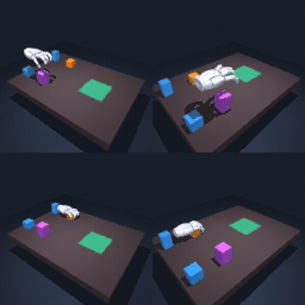

# Planning Track

In this track you keep our pretrained world model and policy frozen and write a better test-time planner. For each validation scene you get a sequence of subgoal images, one every 8 seconds of a scripted reference run. Your planner decides which actions to take and when to move on to the next subgoal.

  

## Pretrained Models and Subgoals

The Colab notebook downloads three files from Hugging Face ([models](https://huggingface.co/YongYong/cis6280-stack-world-models-v2), [datasets](https://huggingface.co/datasets/YongYong/cis6280-stack-datasets-v2)):

1. **World model** (`jepa/smwm-c3/model.pt`) — Encodes each camera frame into a 192-D latent and predicts how that latent will change under a sequence of actions. See the [training track](../training/README.md) for how it was trained.
2. **Policy** (`policy/df-smwm-c1-sigma04/policy.pt`) — A [Diffusion Forcing](https://arxiv.org/abs/2407.01392) policy that proposes the next 16 action blocks (8 seconds of motion) from the current frame.
3. **Subgoal images** (`goals/scripted-val100-every80/goals.npz`) — Frames from a scripted run of the same scene, one every 8 seconds. The full benchmark uses the 300-scene version, `goals/scripted-val300-every80/goals.npz`.

## Quick Start (Google Colab)

Open [`colab.ipynb`](colab.ipynb) in [Google Colab](https://colab.research.google.com/), switch the runtime to a GPU (**Runtime → Change runtime type → GPU**), and click **Runtime → Run all**. In about 15 minutes, the notebook:

1. Installs MuJoCo and downloads the code, hand assets, models, and subgoals.
2. Shows the subgoal images for validation scene `100038`.
3. Defines `GoalPlanningAgent` in a code cell that you can edit.
4. Runs the scene with and without planning and shows both videos.

## How the Baseline Planner Works

The baseline is `GoalPlanningAgent` in [`assignment/training/planning/agent.py`](../training/planning/agent.py), with the same code in `colab.ipynb`. Every 5 control steps (0.5 s), it encodes the current camera frame into a latent $z$ and then:

1. **Picks the active subgoal.** It moves on from subgoal $g_m$ once the current latent is close to it, relative to the distance between $g_m$ and the previous subgoal (for the first subgoal, the episode's first frame):
   $$\|z - g_m\|_2^2 < \tau \, \|g_m - g_{m-1}\|_2^2, \qquad \tau = 0.25.$$
2. **Samples candidates.** The policy proposes 16 candidate action chunks, each 16 blocks (8 s) long.
3. **Imagines and selects.** The world model rolls every candidate forward from the last few frames, and the planner keeps the candidate whose predicted final latent is closest to the subgoal:
   $$n^\star = \arg\min_n \big\|\hat{z}^{(n)}_{\text{final}} - g_m\big\|_2^2.$$
   It executes only the first block of that chunk (5 control steps) and then replans.

### Designing Your Own Planner

To try your own planner for the competition, keep the three downloaded files and the environment loop fixed, and modify `GoalPlanningAgent` in `colab.ipynb` or in [`assignment/training/planning/agent.py`](../training/planning/agent.py). Your agent needs two methods:

- `reset(goal_frames, init_frame, seed=None)` — Called at the start of each episode with the subgoal images (`(M, 128, 256, 3)`, `uint8`), the first frame (`(128, 256, 3)`, `uint8`), and an episode seed.
- `step(frame)` — Called every 5 control steps with the current frame; returns the next 5 actions as a `(5, 25)` `float32` array in `[-1, 1]`.

Some ideas: score the whole predicted trajectory instead of only its last latent, look ahead to several upcoming subgoals, refine candidates iteratively (for example with CEM or MPPI), change how many candidates you sample or how many blocks you execute before replanning (`candidates`, `generate`, `execute`), or detect and recover when a box slips.

## Benchmark to Beat

The full benchmark runs the 300 validation scenes with three policy seeds (`0`, `2`, `3`) and averages the results:

| Selection | ≥1 | ≥2 | ≥3 | 4 | Grasp | Mean boxes |
|---|---|---|---|---|---|---|
| one sample, no goal (`LatentPolicyAgent`) | 81.4% | 35.7% | 8.6% | 1.1% | 99.4% | 1.27 |
| 16 samples, subgoals every 80 steps, τ = 0.25 (`GoalPlanningAgent`) | 85.2% | 41.4% | 11.8% | 2.4% | 99.1% | 1.41 |

`≥1` to `4` are the percentages of episodes whose stack in the goal zone reaches at least that many boxes at some point (boxes standing side by side do not count as a stack), `Grasp` is the percentage of episodes in which the hand grasps a box, and `Mean boxes` is the average peak number of stacked boxes. Planning stacks 0.14 more boxes per episode on average (95% confidence interval 0.06–0.22).

Results vary noticeably with the policy seed (the no-planning baseline ranges from 1.21 to 1.31 mean boxes across the three seeds), so compare planners on the same scenes and seeds and report the average. The evaluation command is in Stage 5 of the [training track](../training/README.md).

Treat these 300 validation scenes as a development set. Competition details, including the held-out evaluation scenes, submission format, and compute limits, will be announced separately.
